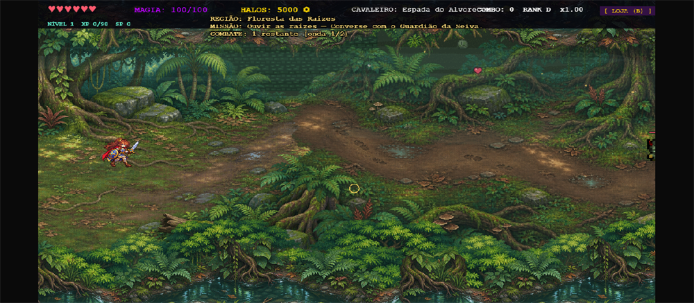
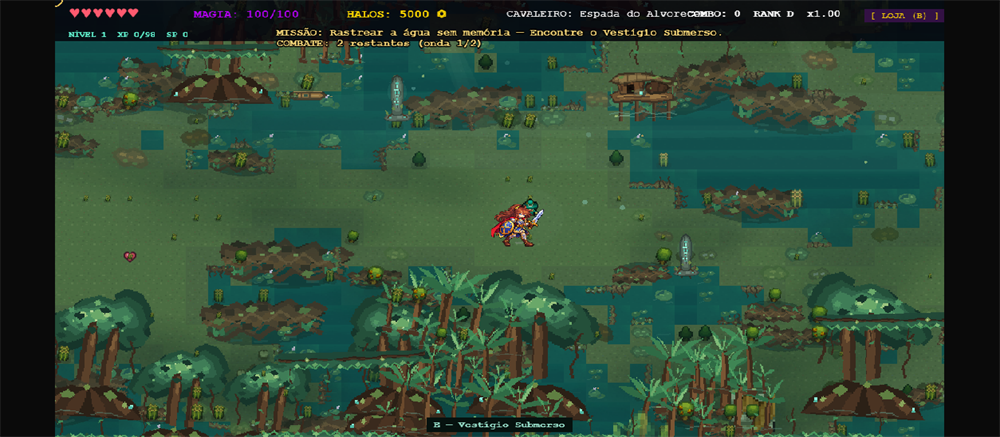
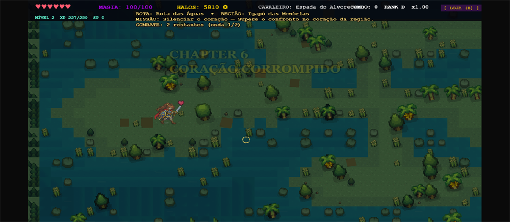
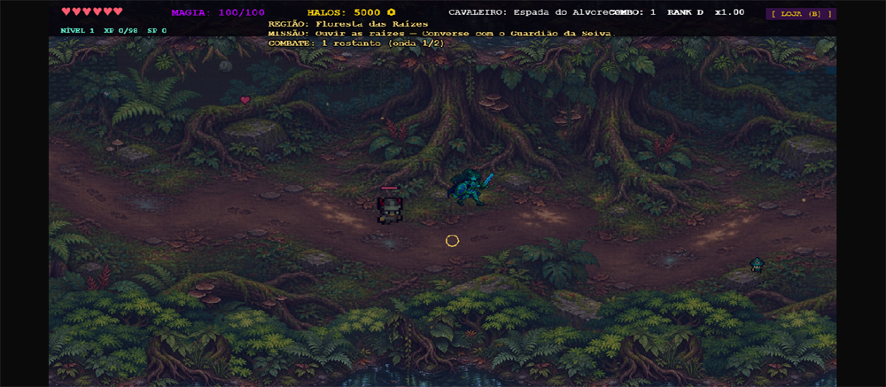
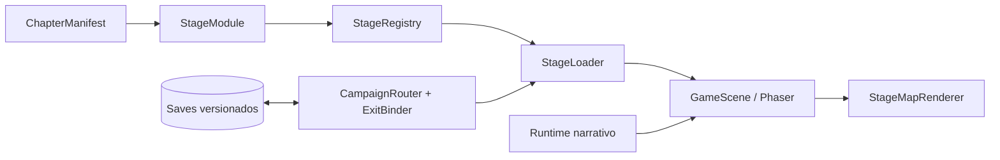
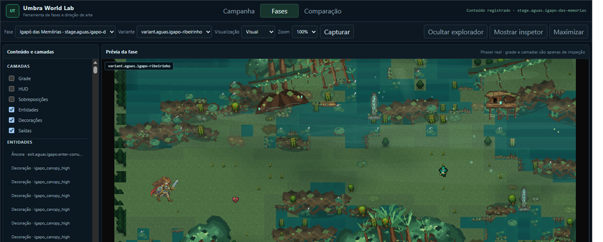

# Umbra Trail

**Uma travessia por florestas inundadas, memórias submersas e rotas que se abrem sob a corrupção.**

Umbra Trail é um RPG de ação 2D top-down em pixel art, jogável no navegador. O jogo combina exploração, combate em tempo real, personagens personalizáveis e capítulos narrativos organizados em rotas de campanha. A floresta, a água e a memória não são apenas cenário: elas definem o ritmo da travessia, os encontros e as passagens que o jogador abre.

O projeto está em desenvolvimento ativo. As fases autorais atuais cobrem a **Floresta das Raízes**, o **Igapó das Memórias** e o **Coração Corrompido**; o restante da campanha usa o esqueleto macro e as fases legadas preservadas durante a migração.

[**Jogar no navegador**](https://icspingu.github.io/dsai-ap1-2Drogue/) · [**Especificações**](./SPEC/README.md) · [**Autoria de fases**](./docs/stage-authoring.md) · [**World Lab**](#world-lab)



*A entrada da Floresta das Raízes. Captura real do build de campanha usado na homologação.*

## O jogo

Umbra Trail é uma aventura de exploração e combate em passagens antigas. O jogador escolhe uma classe, atravessa mapas contínuos em 2D top-down, enfrenta ondas de inimigos, conversa com guardiões e vestígios, cumpre missões e encontra saídas físicas que só se abrem quando a história local é resolvida.

A experiência atual inclui:

- quatro classes jogáveis — **Cavaleiro, Maga, Arqueiro e Ladino** — cada uma com arma própria, ataque especial e invocação;

- combate em tempo real com ataques corpo a corpo e à distância, esquiva, ondas e loja;

- NPCs com diálogos, missões, objetivos, flags e eventos narrativos;

- capítulos e fases com encontros, saídas e condições de progressão;

- campanhas clássicas, compostas e personalizadas, além do modo de fase individual;

- criação de personagem, catálogo de mobs/personagens/armas, ajustes e ferramentas de autoria.

## O mundo

A campanha é organizada em **rotas** e **capítulos**. Cada capítulo é uma unidade de conteúdo com manifesto próprio, fases, apresentação visual e dependências declaradas. A progressão não depende de índices de tela: usa IDs estáveis de capítulo, fase, nó, missão e saída.

### Floresta das Raízes

A primeira travessia. Sob raízes antigas e igarapés, o jogador encontra o **Guardião da Seiva** e precisa ouvir a floresta antes de abrir a **Passagem das Águas**. É o hub inicial da rota macro e a porta de entrada para a Rota das Águas.

### Rota das Águas

A água guarda memórias, mas algo está bebendo essas memórias. No **Igapó das Memórias**, a travessia acompanha margens, canais e ilhas até o **Vestígio Submerso**, que confirma a origem da degradação e desbloqueia a saída. A fase seguinte é o **Coração Corrompido**, onde a nascente da corrupção precisa ser silenciada.

### Além das águas

O esqueleto macro já nomeia outras rotas e regiões — Floresta, Terra, regiões corrompidas e o Palácio do Credor. Elas fazem parte do planejamento da campanha, mas **não são conteúdo autoral jogável desta entrega**. As fases legadas continuam disponíveis no fluxo clássico durante a migração.

## Capturas

As imagens abaixo são capturas reais do Phaser, não mockups. A proveniência e a redução de cada arquivo estão documentadas em [`docs/screenshots/README.md`](./docs/screenshots/README.md).



*Igapó das Memórias — o Vestígio Submerso entre canais, palmeiras e raízes. Variante Ribeirinho.*



*Coração Corrompido — chegada após a transição real de campanha.*



*Combate em tempo real na Floresta das Raízes, com o corpo e a câmera reais do jogo.*

## Funcionalidades implementadas

### Exploração e combate

- Movimento livre em mapas panorâmicos com câmera que acompanha o jogador e limites de mundo.

- Combate em tempo real com ataque primário, especial/ultimate, esquiva e invocação de classe.

- Quatro classes com armas e estilos distintos; o catálogo de armas inclui dano, nível e preço.

- Ondas de inimigos, encontros autorais, itens de cura/mana, loja e progressão por XP, níveis e pontos de habilidade.

- Fases com tiles lógicos de chão, parede, pilar, água, saída, baú, spawn e chefe; o renderer de apresentação não altera a colisão.

### Narrativa e consequências

- NPCs com apresentação própria, diálogos e interação por proximidade.

- Missões com objetivos, filtros e sinais de gameplay (`npc.interacted`, `enemy.defeated`, `item.collected`, `encounter.completed`).

- Flags, eventos, condições e comandos declarativos (`dialogue.start`, `mission.start`, `flag.set`, `exit.unlock`, `stage.complete`, `reward.grant`).

- Escolhas de diálogo são suportadas pelo runtime quando o conteúdo as declara; as fases autorais atuais usam diálogos lineares.

- Exemplos jogáveis: a missão do Guardião da Seiva na Floresta das Raízes e a missão do Vestígio Submerso no Igapó.

### Capítulos e fases

- Dois capítulos de campanha: **Raiz do Mundo** e **Rota das Águas**.

- Três fases autorais com identidade própria: `stage.raiz-do-mundo.santuario`, `stage.aguas.igapo-das-memorias` e `stage.aguas.coracao-corrompido`.

- Fases legadas preservadas em `legacy.verse` para o fluxo clássico e para os testes de compatibilidade.

- Variantes de apresentação para o mesmo mapa e os mesmos pontos de gameplay, como Igapó **Ribeirinho** e **Sombrio**.

- Exits com âncoras por tile, por spawn ou por mapa; a saída do Igapó exige a flag da missão concluída.

### Campanhas e progressão

O menu **Jogar** oferece quatro modos:

| Modo | O que faz |

|---|---|

| **Campanha Clássica** | Preserva o fluxo macro legado, com hub, rotas e saves existentes. É o fluxo homologado de Floresta das Raízes → Igapó → Coração Corrompido. |

| **Campanha Aleatória** | Compõe nove fases a partir do catálogo real usando uma seed. A política **Linear** usa nove instâncias; a **Ramificada** usa dez e inclui bifurcação e reencontro. |

| **Campanha Personalizada** | Permite escolher uma fase para cada posição da composição e validar a seleção antes de iniciar. |

| **Jogar Fase** | Inicia uma fase individual do catálogo real, sem alterar o save da campanha principal. |

A campanha composta salva o progresso, permite retomada e mantém histórico de nós, transições confirmadas e recursos. O fluxo clássico e o composto usam routers e binders distintos, sem compartilhar snapshot.

### Geração e composição procedural

- Templates de geometria `horizontal` e `branched`, com sementes reproduzíveis e `stage-plan.json` para regiões, objetivos e encontros.

- Presets procedurais e regras de composição de campanha no runtime; a seed e o preset são persistidos, não o mapa gerado.

- Validação estática de transitabilidade com o corpo real do jogador (29×39 px no modelo conservador), câmera e satisfatibilidade narrativa.

- **Limite atual:** a campanha composta de nove fases tem cobertura de testes headless e de composição; a execução Phaser completa dessa composição ainda não foi homologada. As fases autorais da rota principal são a parte validada em navegador.

### Persistência

- `umbra-trail-profile` — aparência e classe do personagem.

- `umbra-trail-settings` — som e exibição de comandos.

- `vigrid-progression-v1` — nível, XP, pontos de habilidade, recursos e desbloqueios.

- `umbra-trail-run-v1` — estado versionado da campanha macro, com migração explícita e falha segura.

Saves desconhecidos ou parcialmente incompatíveis preservam os dados reconhecidos e produzem diagnóstico em vez de sobrescrever silenciosamente o progresso.

### Ferramentas de autoria e inspeção

- **Forja de Fases**: editor de tiles com paleta lógica, validação e exportação JSON sobre o formato legado `LevelDefinition`.

- **Umbra World Lab**: inspeção estrutural, prévia Phaser, comparação de variantes, grafo de campanha, diagnósticos e relatórios locais.

- **CLI de capítulos**: criação a partir de template, validação, inspeção, plano, playtest, prévia e homologação.

- **Homologação em Phaser**: executor CDP que percorre NPC, diálogo, missão, combate, saída e campanha com entradas reais.

## Como jogar

### No navegador

A versão publicada da branch `main` fica em:

[https://icspingu.github.io/dsai-ap1-2Drogue/](https://icspingu.github.io/dsai-ap1-2Drogue/)

A publicação é feita pelo workflow [Publicar jogo no GitHub Pages](./.github/workflows/publicar-pages.yml) a cada push na `main`.

### Localmente

Requisitos: **Node.js 20 ou superior** e npm.

```sh

npm install

npm run dev

```

O Vite abre o jogo em `http://localhost:5173/`. No menu:

1. **JOGAR** abre os modos de campanha e de fase individual.

2. **CAMPANHA CLÁSSICA** inicia o fluxo macro preservado.

3. **CAMPANHA ALEATÓRIA** ou **PERSONALIZADA** permite compor uma nova campanha.

4. **EDITAR PERSONAGEM** altera classe, gênero, pele, cabelo, olhos, roupa e sapatos.

5. **CATÁLOGO** consulta mobs, personagens e armas; **AJUSTES** controla som e comandos; **FORJA DE FASES** abre o editor de tiles.

Para gerar a build de produção e servi-la localmente:

```sh

npm run build

npm run preview

```

### Controles

| Ação | Controle |

|---|---|

| Mover | `WASD` ou setas |

| Mirar | mouse |

| Ataque primário | botão esquerdo ou `J` |

| Especial/ultimate | botão direito ou `K` |

| Esquiva | `Espaço` |

| Loja | `B` |

| Menu | `Esc` |

## Arquitetura

O jogo separa **conteúdo declarativo**, **runtime de fases**, **campanha** e **apresentação**. Um capítulo não importa a cena Phaser, o combate, a IA ou os sistemas de progressão; ele declara IDs, mapas, encontros, narrativa e recursos visuais que o runtime valida e carrega.



- `ChapterManifest` agrupa fases e declara dependências e recursos visuais.

- `StageModule` reúne `manifest`, `authoredLevel` (ou layout procedural), `encounter` e dados narrativos.

- `StageRegistry` registra capítulos e fases, valida referências e resolve apresentações e variantes.

- `StageLoader` carrega a fase solicitada, aplica o layout e entrega o nível resolvido ao jogo.

- O runtime narrativo processa flags, missões, eventos, condições e comandos; a saída física só é liberada quando a condição declarada é satisfeita.

- `CampaignRouter`, `CampaignExitBinder` e `PhysicalExitResolver` conduzem a progressão macro e as transições reais entre fases.

- `GameScene` é o adaptador Phaser legado durante a migração; os módulos de capítulo permanecem autocontidos.

- `StageMapRenderer` consome a apresentação resolvida (tiles, decorações, efeitos e ambiente) sem criar colisão nova.

- Saves de campanha usam IDs estáveis de capítulo, fase e revisão de manifesto, com migração versionada.

Os contratos públicos ficam em [`src/stages/contracts/`](./src/stages/contracts/). A arquitetura de campanha modular está descrita em [`SPEC/2026-10-27-arquitetura-campanha-modular.md`](./SPEC/2026-10-27-arquitetura-campanha-modular.md).

## Desenvolvimento de capítulos

O fluxo atual de autoria é:

1. **Consultar capabilities** para saber quais IDs o runtime aceita:

   ```sh

   npm run chapter -- capabilities

   ```

2. **Criar a fase** a partir do template oficial:

   ```sh

   npm run chapter -- create minha-fase --template horizontal --seed 42

   ```

   Os templates disponíveis são `room`, `horizontal` e `branched`.

3. **Planejar o mapa e o conteúdo** em `stage-plan.json` e nos arquivos gerados do capítulo.

4. **Implementar os contratos**: manifesto, mapa, encontro, NPCs, diálogos, missões, eventos e apresentação.

5. **Validar o plano e a fase**:

   ```sh

   npm run chapter -- plan validate minha-fase

   npm run chapter -- validate minha-fase

   npm run chapter -- playtest minha-fase

   ```

6. **Pré-visualizar no navegador**:

   ```sh

   npm run chapter -- preview minha-fase --visual

   npm run dev

   ```

   A URL preparada é `http://localhost:5173/?chapterPreview=minha-fase`.

7. **Homologar no Phaser** com o corpo e as entradas reais:

   ```sh

   npm run chapter -- homologate minha-fase --json

   ```

8. **Verificar a integração com campanhas** antes de promover o capítulo.

Capítulos em autoria ficam em `src/examples/chapters/<slug>/` e **não** entram automaticamente no catálogo de produção. A promoção para `src/stages/chapters/` é manual e exige revisão de IDs, dependências e apresentação.

Detalhes completos, limites arquiteturais e erros comuns estão em [`docs/stage-authoring.md`](./docs/stage-authoring.md) e [`docs/autoria-capitulos-e-assets.md`](./docs/autoria-capitulos-e-assets.md).

## World Lab

O **Umbra World Lab** é a ferramenta de inspeção e validação do projeto. Ele não faz parte da entrada de produção e é marcado como `noindex`; usa os mesmos registries, loaders, validadores e apresentações do jogo.

Durante o desenvolvimento:

```sh

npm run dev

```

Abra `http://localhost:5173/world-lab.html`.

O World Lab permite:

- inspecionar o mapa estrutural, colisões, entidades, decorações, saídas e câmera;

- abrir a prévia Phaser real da fase no modo **Visual**;

- comparar variantes de apresentação sobre o mesmo mapa, como Igapó Ribeirinho e Sombrio;

- visualizar o grafo macro da campanha e inspecionar nós e transições;

- ver a validação estática e de runtime, com PASS/FAIL/UNKNOWN, regiões, coordenadas e sugestões;

- importar ou recarregar relatórios locais de homologação;

- alternar sobreposições, camadas e diagnóstico sem alterar o estado do jogo.

Exemplo de inspeção direta do Igapó na variante Ribeirinho:

```text

http://localhost:5173/world-lab.html?stage=stage.aguas.igapo-das-memorias&presentationVariant=variant.aguas.igapo-ribeirinho

```



*World Lab em modo Visual, com a prévia Phaser do Igapó e o painel de validação.*

**Limitações:** o World Lab depende do Vite para servir os relatórios locais; capítulos de autoria são descobertos por `import.meta.glob` e exigem reinício do servidor após a criação; fases legadas e procedurais não recebem a mesma validação estática de autoria.

## Testes e homologação

O projeto diferencia três níveis de verificação:

| Nível | Comando | O que comprova |

|---|---|---|

| Testes automatizados | `npm test -- --runInBand` | Contratos, runtime, campanhas, narrativa, renderer, World Lab e regressões headless. |

| Build e tipos | `npm run build` | `tsc --noEmit` e build do Vite. |

| Gates do repositório | `npm run check:gates` | Fronteiras arquiteturais e rastreabilidade de SPECs/prompts. |

| Validação de capítulo | `npm run chapter -- validate <slug>` | Manifesto, referências, loader, narrativa e catálogo. |

| Playtest estático | `npm run chapter -- playtest <slug>` | Transitabilidade com o corpo real, plano, câmera e satisfatibilidade narrativa. |

| Homologação individual | `npm run homologate -- <slug> --json` | Execução Phaser real de NPC, diálogo, missão, combate, saída e conclusão. |

| Homologação de campanha | `npm run homologate -- --campaign --json` | Fluxo macro real com transição, spawn, persistência e isolamento. |

A homologação individual do Igapó Natural e Sombrio foi executada com **PASS**; como o preview individual carrega apenas uma fase, a transição para a próxima cena é registrada como **UNKNOWN** nesse modo. A homologação de campanha comprovou **Floresta das Raízes → Igapó → Coração Corrompido** com **PASS**, incluindo spawn, movimento, câmera, persistência, recompensas e isolamento de estado.

A campanha composta de nove fases é coberta por testes headless (`campaignIntegrationCycle` e correlatos), não por uma execução Phaser completa. O retorno Coração → Igapó pode aparecer como UNKNOWN opcional quando a saída de retorno não está disponível no contexto.

Relatórios e capturas de runtime ficam em `.tmp/evidence-913/` e `.tmp/evidence-914/` e não são versionados. O resumo do estado atual da suíte local é **93 suítes e 1.174 testes** aprovados, além de `check:gates`, `build` e `git diff --check`.

## Tecnologias

| Tecnologia | Uso | Faixa declarada | Licença |

|---|---|---|---|

| [Phaser](https://phaser.io/) | Engine 2D, Arcade Physics, áudio e input | `^3.70.0` | MIT |

| TypeScript | Tipagem e contratos declarativos | `^5.4.0` | Apache-2.0 |

| Vite | Servidor local e build | `^5.2.0` | MIT |

| Jest | Testes automatizados | `^29.7.0` | MIT |

| ts-jest | Transformação TypeScript no Jest | `^29.1.2` | MIT |

| Node.js | Runtime local e CI | 20 no GitHub Actions | — |

| GitHub Actions / Pages | Validação, build e publicação | `actions/*` | — |

As versões acima são as faixas declaradas em `package.json`; o lockfile pode resolver versões compatíveis mais recentes dentro da faixa.

## Estado do desenvolvimento

**Implementado e jogável**

- Quatro classes, combate, esquiva, loja, itens, progressão e catálogo.

- Floresta das Raízes, Igapó das Memórias e Coração Corrompido com NPCs, missões, encontros e saídas.

- Campanha Clássica homologada em Phaser até o Coração Corrompido.

- Campanhas Aleatória, Personalizada e modo Jogar Fase.

- World Lab, CLI de capítulos, playtest estático e homologação em navegador.

- Persistência versionada de perfil, ajustes, progressão e campanha.

**Parcial ou em migração**

- A campanha composta de nove fases tem cobertura headless, mas ainda não foi homologada por uma execução Phaser completa.

- O fluxo clássico ainda usa fases legadas e placeholders visuais em parte da rota; a migração para capítulos autorais é incremental.

- Outras rotas e regiões do esqueleto macro estão nomeadas, mas não são conteúdo autoral jogável desta entrega.

- O retorno Coração → Igapó é UNKNOWN opcional no relatório de campanha atual.

**Próximos trabalhos**

- Ampliar a campanha autoral para as demais rotas e regiões.

- Homologar a composição procedural completa no Phaser.

- Consolidar a promoção de capítulos de autoria para o catálogo de produção.

- Continuar a substituição de placeholders legados por apresentações de capítulo.

## Créditos e licenças

### Equipe

| Integrante | GitHub |

|---|---|

| Guilherme Sandim | [@gguisandim](https://github.com/gguisandim) |

| Jonas Bragança | Perfil GitHub não informado |

### Assets e dependências

- **Puny World (16×16)** e **Puny Characters — edição gratuita**, de **Shade**, licença **CC0**: [tileset](https://opengameart.org/content/16x16-puny-world-tileset) e [personagens](https://opengameart.org/content/puny-characters). Procedência, hashes e transformações em [`src/assets/puny/README.md`](./src/assets/puny/README.md).

- **Arte original do projeto**: composições da Floresta das Raízes, SVGs do Igapó e a canoa, documentados em [`src/assets/world-root/README.md`](./src/assets/world-root/README.md) e [`src/assets/aguas/README.md`](./src/assets/aguas/README.md).

- Phaser, TypeScript, Vite, Jest e ts-jest mantêm as licenças indicadas na tabela de tecnologias.

- O repositório não inclui um arquivo `LICENSE` próprio. O código e a arte originais pertencem aos autores do projeto; consulte a equipe antes de redistribuir.

### Processo e rastreabilidade

- [Índice de especificações](./SPEC/README.md)

- [Guia de autoria de fases](./docs/stage-authoring.md)

- [Registro de prompts](./prompts/registro-completo.md)

- [Auditoria de segredos em prompts](./scripts/auditar-segredos-prompts.ps1)

Mudanças assistidas seguem o processo do repositório: a SPEC é registrada antes da implementação, e os commits mantêm os trailers `Agent:` e `Spec:` quando aplicáveis.
