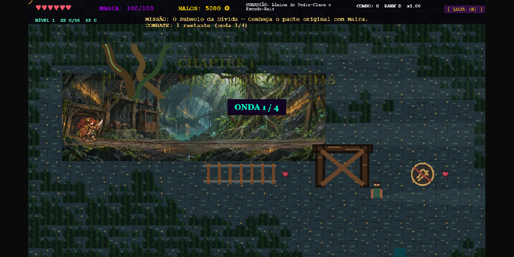
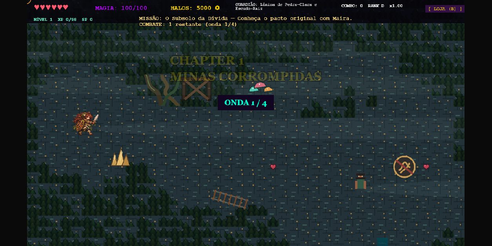
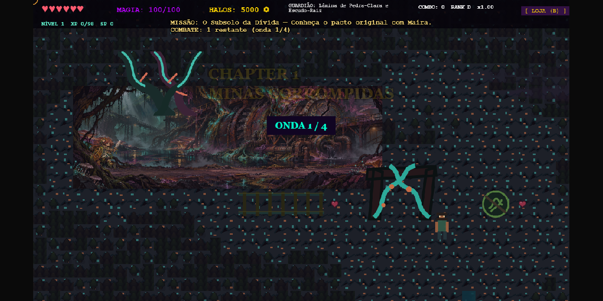
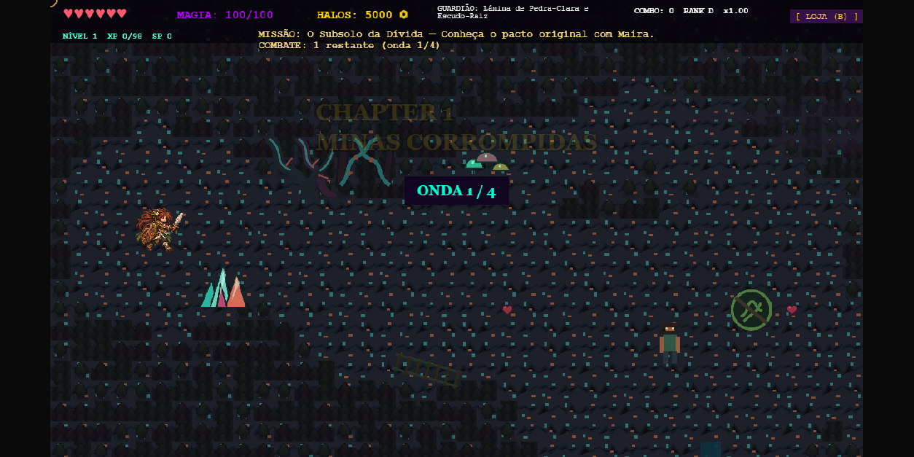

# Minas Corrompidas — composição da entrada

Capturas reais do Phaser, em Edge headless 158.0.4370.33, viewport 1280×720.
Antes e depois usam o mesmo marco de entrada (`region.corrupted.minas.floresta`,
âncora 5,14), câmera e executor. Os comandos de captura navegaram pelos sete
marcos do plano e passaram em ambas as variantes; este conjunto preserva as
quatro imagens da entrada.

## Abandonada — `variant.corrupted.minas.abandoned`

| Antes | Depois |
|---|---|
|  |  |

## Corrompida — `variant.corrupted.minas.corrupted`

| Antes | Depois |
|---|---|
|  |  |

## Execuções

Antes:

```sh
npm run homologate -- --stage stage.corrupted.minas --variant variant.corrupted.minas.abandoned --capture --evidence-dir .tmp/minas-visual-before/abandoned
npm run homologate -- --stage stage.corrupted.minas --variant variant.corrupted.minas.corrupted --capture --evidence-dir .tmp/minas-visual-before/corrupted
```

Depois, após a última alteração:

```sh
npm run homologate -- --stage stage.corrupted.minas --variant variant.corrupted.minas.abandoned --capture --evidence-dir .tmp/minas-visual-final/abandoned-verified
npm run homologate -- --stage stage.corrupted.minas --variant variant.corrupted.minas.corrupted --capture --evidence-dir .tmp/minas-visual-final/corrupted
```

As quatro execuções retornaram `PASS`; os sete marcos alcançáveis foram
confirmados em cada captura.
