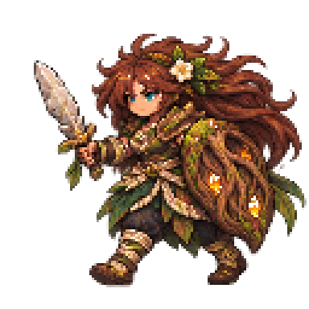
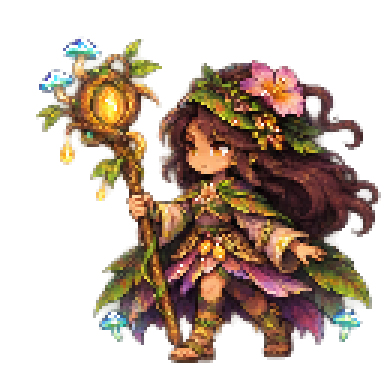
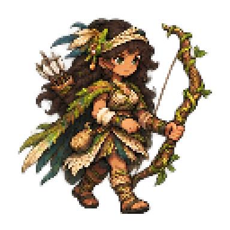
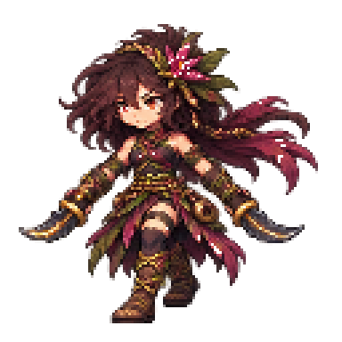

# Evidências — classes amazônicas

Capturas produzidas pelo Phaser real por `scripts/homologate-chapter.mjs`, em
Microsoft Edge headless 157, resolução 1280 × 720. Cada relatório verifica a
classe carregada, o display 86 × 76, a hitbox-fonte 42 × 58 com offset 43 × 48,
a caminhada e o ataque. O Rastreador usa a soltura articulada do arco, conforme
o contrato existente, em vez da animação `_attack` comum às outras classes.

## Comparativo antes/depois

| Classe | Antes | Depois |
| --- | --- | --- |
| Guardião do Cerne |  |  |
| Condutor das Sementes |  |  |
| Rastreador do Igapó |  |  |
| Lâmina do Cipó |  |  |

## Igapó das Memórias — variantes femininas

| Classe | Seleção | Caminhada | Ataque | Relatório |
| --- | --- | --- | --- | --- |
| Guardião | [PNG](igapo-knight-woman/04-selection.png) | [PNG](igapo-knight-woman/02-walk.png) | [PNG](igapo-knight-woman/03-attack.png) | [PASS](igapo-knight-woman/player-showcase.json) |
| Condutor | [PNG](igapo-mage-woman/04-selection.png) | [PNG](igapo-mage-woman/02-walk.png) | [PNG](igapo-mage-woman/03-attack.png) | [PASS](igapo-mage-woman/player-showcase.json) |
| Rastreador | [PNG](igapo-ranger-woman/04-selection.png) | [PNG](igapo-ranger-woman/02-walk.png) | [PNG](igapo-ranger-woman/03-attack.png) | [PASS](igapo-ranger-woman/player-showcase.json) |
| Lâmina | [PNG](igapo-rogue-woman/04-selection.png) | [PNG](igapo-rogue-woman/02-walk.png) | [PNG](igapo-rogue-woman/03-attack.png) | [PASS](igapo-rogue-woman/player-showcase.json) |

## Jardins Velados — variantes masculinas

| Classe | Seleção | Caminhada | Ataque | Relatório |
| --- | --- | --- | --- | --- |
| Guardião | [PNG](gardens-knight-man/04-selection.png) | [PNG](gardens-knight-man/02-walk.png) | [PNG](gardens-knight-man/03-attack.png) | [PASS](gardens-knight-man/player-showcase.json) |
| Condutor | [PNG](gardens-mage-man/04-selection.png) | [PNG](gardens-mage-man/02-walk.png) | [PNG](gardens-mage-man/03-attack.png) | [PASS](gardens-mage-man/player-showcase.json) |
| Rastreador | [PNG](gardens-ranger-man/04-selection.png) | [PNG](gardens-ranger-man/02-walk.png) | [PNG](gardens-ranger-man/03-attack.png) | [PASS](gardens-ranger-man/player-showcase.json) |
| Lâmina | [PNG](gardens-rogue-man/04-selection.png) | [PNG](gardens-rogue-man/02-walk.png) | [PNG](gardens-rogue-man/03-attack.png) | [PASS](gardens-rogue-man/player-showcase.json) |

As capturas `01-idle.png` de cada pasta completam a inspeção de repouso. A
revisão visual confirmou silhuetas distintas, leitura em cenário alagado e em
floresta clara, ausência de colisão entre os textos do criador e o retrato, e
HUD de arma sem sobreposição com combo ou loja.
